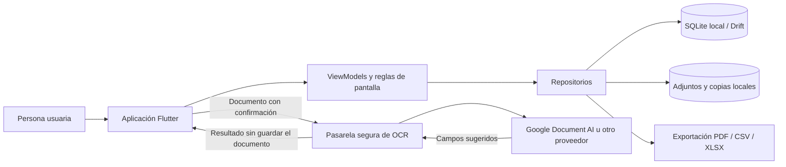

# Arquitectura técnica — Control de gastos

**Versión:** 0.1  
**Estado:** propuesta para revisión  
**Fecha:** 5 de noviembre de 2026  
**Relacionada con:** [Especificación funcional v0.2](especificacion-funcional-v0.2.md)

## 1. Decisiones principales

| Área | Propuesta | Motivo |
|---|---|---|
| Aplicación | Flutter y Dart | Permite comenzar en Windows y compartir buena parte del código con Android, iOS y web. Cada plataforma requerirá adaptar y validar sus pantallas. |
| Persistencia Windows | SQLite local mediante Drift | Los datos son estructurados y relacionales; Drift añade consultas tipadas, flujos reactivos y migraciones de esquema. |
| Organización | Vistas + ViewModels + repositorios + servicios | Separa la interfaz de las reglas y del almacenamiento, permitiendo cambiar la base local o incorporar una API sin rehacer pantallas. |
| OCR | Servicio cloud de reconocimiento detrás de una pasarela propia | Evita incluir claves privadas del proveedor en el instalador y permite controlar tamaño, uso y tratamiento de documentos. |
| Archivos adjuntos | Archivos locales con metadatos en SQLite | Evita guardar imágenes y PDF grandes como datos binarios dentro de la base. |
| Instalación | Instalador de Windows por usuario | Reduce la necesidad de permisos de administrador y mantiene los datos en el perfil de Windows. |

Flutter documenta SQLite local como alternativa para datos relacionales que no necesitan sincronización inicial y Drift como opción multiplataforma. Su guía recomienda separar la UI de los datos y usar ViewModels, repositorios y servicios. [Persistencia y bases de datos](https://docs.flutter.dev/data-and-backend/persistence/choose-a-database), [arquitectura de Flutter](https://docs.flutter.dev/app-architecture/guide), [plataformas compatibles](https://docs.flutter.dev/reference/supported-platforms).

## 2. Vista general



Las operaciones habituales no dependen de internet. La conexión se usa solo para procesar el documento que el usuario seleccione y para futuras funciones sincronizadas, si se aprueban.

## 3. Estructura de la aplicación

La aplicación se organizará por funciones para que cada área sea fácil de ampliar:

```text
lib/
  app/             inicio, rutas, tema, manejo de sesión
  core/            formato COP, fechas, errores, validaciones compartidas
  features/
    auth/          perfiles e inicio/cierre de sesión local
    dashboard/     resumen y gráficos
    expenses/      listado, detalle, formulario y papelera
    categories/    categorías y métodos de pago
    reports/       filtros e informes
    attachments/   selección, almacenamiento y visualización
    backup/        copia y restauración
    settings/      preferencias y perfil
  data/
    database/      SQLite/Drift y migraciones
    repositories/  acceso local y reglas de persistencia
    services/      sistema de archivos y clientes de servicios externos
```

Cada función tendrá una vista para presentar datos y un ViewModel para gestionar estado y acciones. Los repositorios serán la fuente de verdad de los datos. Los servicios encapsularán SQLite, archivos, OCR y funcionalidades del sistema operativo. Se añadirá una capa de casos de uso solo cuando una regla compleja necesite reutilizarse.

## 4. Componentes y responsabilidades

### Estado implementado

La primera compilación funcional usa tablas `profiles`, `expense_categories`, `expenses`, `incomes` y `expense_attachments`, con `profile_id` como separación de datos. El modelo con libros (`ledgers` y `ledger_members`) sigue siendo el diseño objetivo si se confirma que habrá libros compartidos; antes de habilitar esa modalidad habrá que añadir la relación y migrar los registros existentes.

La interfaz inicial ya incluye perfiles con clave local, categorías, ingresos y gastos, adjuntos locales, saldo acumulado, papelera y exportación PDF/CSV/XLSX. No incluye todavía OCR ni copias de seguridad.

### Aplicación Windows

- Presenta todas las pantallas y gestiona navegación y sesión activa.
- Valida campos y muestra errores comprensibles.
- Ejecuta cálculos de totales e informes localmente.
- Persiste gastos, categorías y perfiles mediante repositorios.
- Exporta informes en el equipo.
- Solicita consentimiento justo antes de enviar un documento a OCR.

### Base de datos local

Tablas iniciales propuestas:

| Tabla | Contenido principal |
|---|---|
| `profiles` | Identificador, nombre visible, estado, fecha de creación y referencia al verificador de clave. |
| `ledgers` | Libro de gastos. Inicialmente, un libro privado por perfil. |
| `ledger_members` | Relación entre perfil y libro; permite evolucionar a libros compartidos. |
| `categories` | Nombre, color/ícono, orden, estado activo/archivado y libro propietario. |
| `payment_methods` | Nombre, orden y estado activo/archivado. |
| `expenses` | Importe, fecha, nombre, categoría, método, comercio, nota, libro, creador, modificador y campos de papelera. |
| `incomes` | Importe, fecha, nombre, origen, nota, perfil y campos de papelera. |
| `attachments` | Tipo, ruta local relativa, tamaño, huella del archivo y gasto asociado. |
| `schema_info` | Versión de esquema para migraciones y restauración compatible. |

Los importes se guardarán como entero en unidades menores de COP para evitar errores de punto flotante; la interfaz presentará COP de forma local y normalmente sin decimales. Cada fila tendrá un UUID estable. Las fechas de gasto serán fechas de calendario; los sellos técnicos de creación y actualización se almacenarán en UTC y se presentarán en America/Bogota.

La papelera se modelará con `deleted_at` y `deleted_by`. Los informes excluirán los gastos en papelera. La eliminación definitiva será una operación explícita y separada.

### Archivos y respaldos

- Los adjuntos se guardarán en carpetas de datos de la aplicación, no dentro de la base de datos.
- Las rutas guardadas serán relativas a la carpeta de datos para facilitar mover y restaurar el conjunto.
- La aplicación comprobará que un adjunto exista antes de abrirlo y mostrará un error recuperable si falta.
- Una copia incluirá la base de datos, perfiles, categorías, adjuntos y un manifiesto con versión y fecha.
- La restauración validará la copia y creará una copia de seguridad de los datos actuales antes de sustituirlos.
- La copia podrá protegerse con una contraseña. Este mecanismo se debe definir junto con la política de cifrado local.

### Inicio de sesión local

- La sesión activa se conservará solo durante la ejecución; el usuario podrá cerrar sesión y cambiar de perfil.
- Se guardará un verificador de contraseña derivado con una biblioteca criptográfica mantenida, nunca la contraseña en texto plano.
- Los campos `created_by` y `updated_by` se asignarán desde la sesión, no desde valores ingresados en el formulario.
- El aislamiento de registros en repositorios se aplicará siempre por `ledger_id` activo.
- El inicio local identifica perfiles dentro de la aplicación; no equivale a una cuenta en línea ni protege frente a otra persona con acceso directo a los archivos del mismo Windows. La decisión de cifrar la base y los adjuntos en reposo debe cerrarse antes de implementar el login.

## 5. OCR y seguridad de credenciales

La aplicación de escritorio no incluirá una clave API del proveedor: cualquier secreto distribuido dentro del `.exe` podría extraerse. El flujo propuesto es:

1. La aplicación limita el archivo al tipo, tamaño y páginas permitidos.
2. Solicita confirmación y explica que el documento se enviará a un servicio externo.
3. Envía el archivo por HTTPS a una pasarela de OCR.
4. La pasarela valida autorización, límites de uso y tamaño, y reenvía la solicitud al proveedor.
5. La pasarela devuelve campos estructurados y elimina cualquier archivo temporal; no guarda recibos ni resultados de forma permanente.
6. La aplicación permite corregir los datos antes de guardarlos como gasto.

La pasarela introduce un componente en la nube, aunque los gastos y adjuntos sigan locales. Antes de habilitar OCR en producción se deberán definir el proveedor, la región, el costo, la política de retención, límites por usuario y una forma de evitar abuso del endpoint. Las claves permanecerán en el servidor y los registros técnicos no contendrán imágenes ni datos personales del recibo.

## 6. Modelo de acceso flexible

La especificación funcional v0.2 establece provisionalmente que cada perfil verá sus propios gastos. Como todavía falta confirmar si se desea una lista compartida, los gastos se asociarán a un `ledger_id` y los perfiles a uno o más libros mediante `ledger_members`.

- **Supuesto inicial:** cada perfil tiene su propio libro privado.
- **Si se elige un libro común:** los perfiles se vinculan al mismo libro y cada gasto conserva quién lo creó o modificó.
- Esta decisión cambia reglas de acceso y pantallas, pero no requiere cambiar la estructura principal de gastos.

## 7. Evolución a móvil y web

- Android e iOS podrán reutilizar la mayor parte de UI, reglas y modelos.
- El almacenamiento se abstraerá detrás de repositorios. En móvil podrá seguir siendo local inicialmente.
- La web podría usar persistencia local del navegador para la fase de prueba, pero la versión multi-dispositivo deberá usar una API y una base de datos central, con autenticación y sincronización explícitas.
- Cada registro tendrá UUID, fecha de actualización y versión de esquema desde la primera versión.
- La sincronización y resolución de conflictos no se implementarán hasta definir cómo se vinculan los perfiles locales con cuentas en línea y cómo se comparten libros.

## 8. Orden de implementación sugerido

1. Confirmar modelo de perfiles y cifrado local.
2. Crear base Flutter para Windows, navegación y tema visual. **Completado.**
3. Implementar perfiles locales, sesión y migración inicial de SQLite. **Completado para esquema inicial.**
4. Implementar categorías, ingresos, gastos, lista y papelera. **Completado para flujo básico.**
5. Implementar resumen mensual e informes filtrables. **Completado para primera entrega.**
6. Implementar exportación PDF, CSV y XLSX. **Completado para primera entrega.**
7. Implementar adjuntos, copias de seguridad y restauración.
8. Integrar la pasarela OCR y validar reconocimiento con recibos colombianos de prueba.
9. Preparar y verificar instalador por usuario para Windows.

La selección concreta de paquetes de gráficos, XLSX, PDF, cifrado e instalador se hará justo antes de programar cada componente, comprobando mantenimiento y compatibilidad con la versión estable disponible en ese momento.

## 9. Decisiones pendientes

1. **Datos por perfil o compartidos:** sigue pendiente la respuesta. Hasta entonces se usa como supuesto un libro privado por perfil, con soporte de modelo para compartir posteriormente.
2. **Cifrado local:** decidir si se cifran base y adjuntos con una clave protegida por Windows, y cómo afectará a la recuperación de clave y a copias de seguridad.
3. **Proveedor y despliegue OCR:** confirmar Google Document AI y elegir región, hosting de la pasarela, límites de uso y responsable de los costos.
4. **Nombre y estilo visual:** pendiente.

